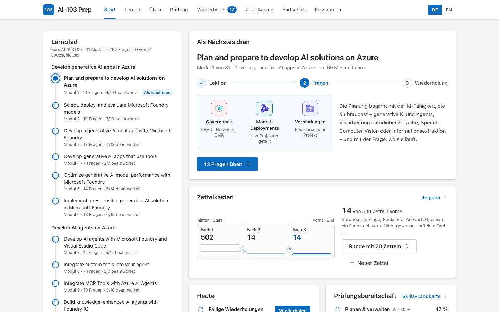
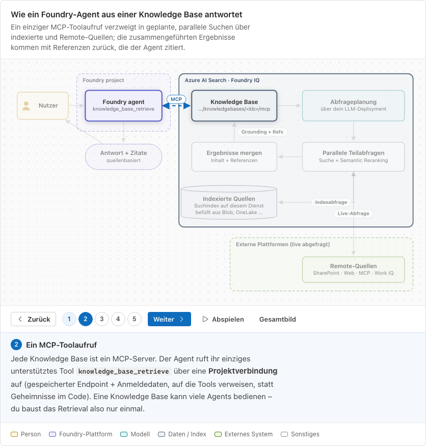
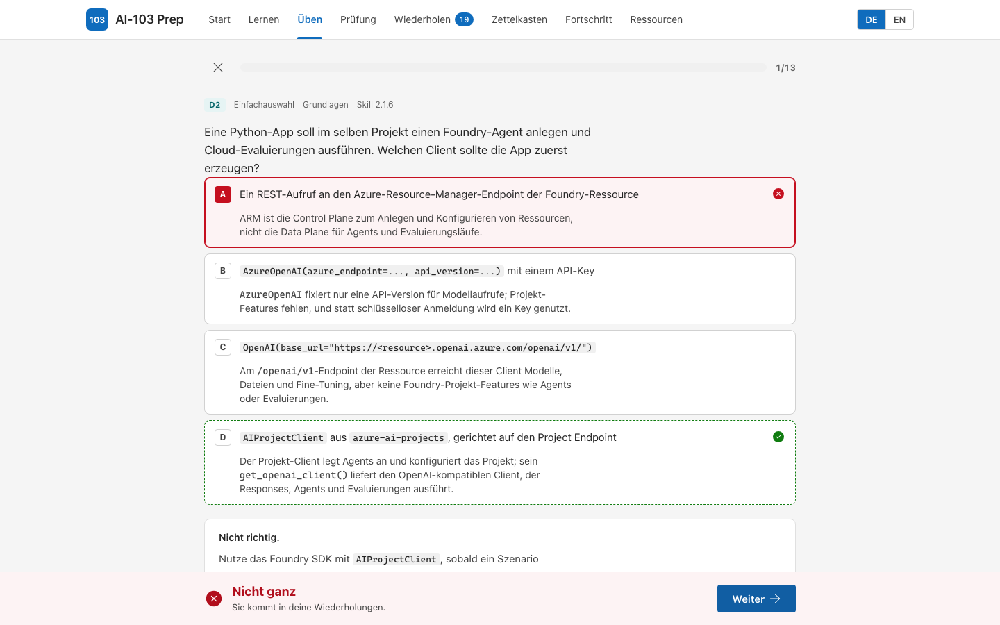
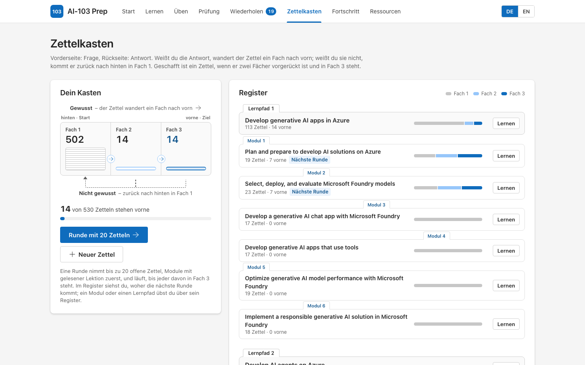

# AI-103 Prep

Lern-App für die Microsoft-Prüfung **AI-103: Developing AI Apps and Agents on Azure**. Wer die Prüfung besteht, erhält die Zertifizierung *Microsoft Certified: Azure AI Apps and Agents Developer Associate*.

Die App folgt dem offiziellen Kurs **AI-103T00** (4 Lernpfade, 31 Module) und dem Skills-Katalog *„skills measured as of April 16, 2026“*. Zu jedem Modul gibt es eine bebilderte Lektion mit Schritt-für-Schritt-Diagrammen, eigene Übungsfragen und Karteikarten für den Zettelkasten. Alles läuft im Browser: kein Backend, kein Konto.

**Online:** <https://jeffrey-groneberg.github.io/ai103-prep/> – im Browser am Rechner oder Handy; auf Wunsch als App installierbar und offline nutzbar (siehe [Online und als App](#online-und-als-app)).

**Stand:** Inhalte zuletzt mit Microsoft Learn abgeglichen am **9. November 2026**.

> [!IMPORTANT]
> Kein offizielles Microsoft-Produkt. Alle Fragen sind eigene Formulierungen auf Basis der aktuellen Microsoft-Learn-Dokumentation – keine echten Prüfungsfragen und keine Dumps. Details unter [Inhaltsrichtlinie](#inhaltsrichtlinie).



## Schnellstart

Voraussetzung: Node.js 22.18 oder neuer (entwickelt mit Node 26).

```bash
npm install      # nur beim ersten Mal und nach Updates
npm run dev      # jeden Tag zum Starten
```

Dann <http://localhost:5173> öffnen. Beenden mit `Strg+C` im Terminal.

> [!NOTE]
> Dein Lernstand liegt im Browser – und zwar **pro Browser und pro Adresse**. Bleib deshalb bei einem Browser und einer Adresse: der [Online-Version](https://jeffrey-groneberg.github.io/ai103-prep/) oder lokal `http://localhost:5173`. Ist Port 5173 schon belegt, bricht der Start mit einer Meldung ab, statt still auf einen anderen Port auszuweichen (dort wäre dein Lernstand leer). Sichere den Lernstand ab und zu unter **Fortschritt → Exportieren**.

## Online und als App

Die App ist unter <https://jeffrey-groneberg.github.io/ai103-prep/> veröffentlicht und läuft in jedem aktuellen Browser, am Rechner wie am Handy. Zusätzlich kannst du sie als App installieren; dann startet sie vom Home-Bildschirm ohne Browserleiste:

| Gerät | So installierst du die App |
|---|---|
| iPhone, iPad (Safari) | Teilen-Symbol → **Zum Home-Bildschirm** |
| Android (Chrome) | Menü ⋮ → **App installieren** bzw. **Zum Startbildschirm hinzufügen** |
| Windows, macOS (Edge, Chrome) | Installieren-Symbol rechts in der Adressleiste |

- **Offline:** Nach dem ersten Öffnen funktionieren Lektionen, Diagramme, Fragen, Wiederholung, Zettelkasten und Prüfungssimulation ohne Internet. Nur die Links zu Microsoft Learn brauchen eine Verbindung.
- **Updates:** Jeder Push auf `main` prüft (`npm run check`), baut und veröffentlicht die Seite neu – siehe `.github/workflows/pages.yml`. Die App lädt die neue Version beim nächsten Start.
- **Lernstand:** Die Online-Version und `localhost:5173` haben getrennte Lernstände. Auf dem iPhone hat die installierte App zusätzlich einen eigenen Lernstand, getrennt von Safari. Umziehen kannst du ihn mit **Fortschritt → Exportieren** und **Importieren**.
- **Sichtbarkeit:** Das Repository ist privat, die Seite selbst ist öffentlich: Wer den Link kennt, kann sie öffnen. Suchmaschinen werden gebeten, sie nicht aufzunehmen (`noindex`).

## So lernst du damit

1. **Dem Lernpfad folgen.** Die Karte „Als Nächstes dran“ auf **Start** zeigt immer den nächsten Schritt: Lektion lesen → Fragen des Moduls üben → Fehler wiederholen.
2. **Täglich:** zuerst die fälligen Wiederholungen, dann eine Runde im **Zettelkasten** oder eine kurze Runde mit 10 gemischten Fragen – beides geht auch am Handy.
3. **Einmal pro Woche:** eine Prüfungssimulation. Die Auswertung je Domäne zeigt, wo du nacharbeiten solltest.
4. **Praxis:** Die meisten Learn-Module enthalten eine Übung zum Mitmachen in einem eigenen Azure-Abonnement. Die App ersetzt diese Übungen nicht; jede Lektion verlinkt ihr Modul.
5. **Vor der Anmeldung:** das offizielle [Practice Assessment](http://aka.ms/AI103-PA) und die [Exam Sandbox](https://aka.ms/examdemo).

**Wann bist du bereit?** Eine offizielle Umrechnung gibt es nicht. Richtwert der App: Simulationen stabil deutlich über 70 %, alle Domänen auf der Skills-Landkarte mindestens „Sicher“ und ein gutes Ergebnis im offiziellen Practice Assessment.

## Was die App bietet

| Bereich | Was du dort machst |
|---|---|
| **Start** | Siehst, welche Lektion als Nächstes dran ist, und startest direkt etwas für heute: fällige Wiederholungen, eine kurze Runde mit 10 gemischten Fragen oder die Prüfungssimulation. |
| **Lernen** | 31 Lektionen, eine pro offiziellem Modul: Worum geht’s, Prüfungsfokus, Schritt-für-Schritt-Diagramm, Kernkonzepte, „Welcher Dienst wofür?“, minimaler Python-Code, Prüfungsfallen, Merksätze, Mini-Quiz und Link zum Modul auf Learn. |
| **Üben** | Lernmodus mit sofortigem Feedback und einer Erklärung zu jeder Antwortoption. Filter nach Domäne, Modul, Skill, Schwierigkeit und Fragetyp. |
| **Prüfung** | Simulation mit Zeitlimit: 50 Fragen in 100 Minuten, nach Domänen gewichtet, mit einer Fallstudie am Ende – oder kompakt mit 25 Fragen in 50 Minuten. Danach eine Auswertung je Domäne. |
| **Wiederholen** | Falsch oder nur teilweise richtig beantwortete Fragen kommen nach dem Leitner-Prinzip wieder: Fächer 1–5, fällig nach 0, 1, 3, 7 und 21 Tagen. |
| **Zettelkasten** | Karteikarten, vorbefüllt aus allen Lektionen, dazu deine eigenen Zettel. Jede Frage beantwortest du wie in der Prüfung mit einer von vier Antwortoptionen; danach erklärt der Zettel kurz, warum jede Option stimmt oder nicht. Richtig: Der Zettel wandert ein Fach nach vorn; falsch: zurück nach hinten in Fach 1. Ziel: alle Zettel in Fach 3. Siehe [Zettelkasten](#zettelkasten). |
| **Fortschritt** | Skills-Landkarte je Domäne und Modul. Lernstand exportieren, importieren oder zurücksetzen. |
| **Abdeckung** | Abdeckungsmatrix: Skill → Modul → Lektion → Fragen. |
| **Ressourcen** | Study Guide, Kurs, Lernpfade und Module auf Learn, Practice Assessment, Exam Sandbox – dazu John Savills AI-103 Study Cram als Wiederholung aus der Community und der Agent-Skill [exam-prep-app](https://github.com/jeffrey-groneberg/exam-prep-app-skill), mit dem du so eine App für deine eigene Prüfung baust. |

**Fehler melden:** Jede Frage, jeder Lektionsabschnitt, jedes Diagramm, jedes Codebeispiel und jeder Zettel hat einen Feedback-Link. Er öffnet in diesem Repository ein neues GitHub-Issue, in dem schon steht, wo es klemmt (Frage- oder Zettel-ID, Modul, Textauszug, Seite, Sprache, App-Version); du beschreibst nur noch, was nicht stimmt. Dafür brauchst du ein GitHub-Konto.

Die Oberfläche ist deutsch. Lektionen, Fragen und Zettel schaltest du zwischen Deutsch und Englisch um; auf Englisch übst du die Begriffe so, wie sie in der Prüfung stehen. Am Handy erreichst du Zettelkasten, Fortschritt, Ressourcen und Abdeckung über das Menü oben rechts; der Zettelkasten steht außerdem auf der Startseite direkt unter „Als Nächstes dran“.

| Lektion mit Diagramm | Übungsfrage mit Erklärung |
|---|---|
|  |  |

## Zettelkasten

Der Zettelkasten ist eine Lernkartei nach Leitner mit drei Fächern:

1. Jeder Zettel startet hinten im Kasten in **Fach 1**. Auf der Vorderseite steht eine Frage mit vier Antwortoptionen wie in der Prüfung, genau eine ist richtig.
2. Du wählst eine Option und prüfst. Danach zeigt der Zettel die richtige Antwort und erklärt zu **jeder Option kurz, warum** sie stimmt oder nicht; der Text aus der Lektion steht unter „Aus der Lektion“. **Richtig:** Der Zettel wandert ein Fach nach vorn. **Falsch:** Er kommt zurück nach hinten in Fach 1. Tastatur: 1–4 oder A–D wählt, Enter prüft und geht weiter.
3. Geschafft ist ein Zettel, wenn er zwei Fächer vorgerückt ist und vorne in **Fach 3** steht. Eine Runde nimmt bis zu 20 offene Zettel (Module mit gelesener Lektion zuerst) und läuft, bis jeder davon in Fach 3 steht. Im **Register** (ein Reiter pro Lernpfad und pro Modul) übst du gezielt die Zettel eines Moduls oder eines Lernpfads; „Nächste Runde“ zeigt, woher die nächste gemischte Runde kommt.

- **Vorbefüllt:** 530 Zettel, einer pro Kernkonzept, Prüfungsfalle und Merksatz jeder Lektion (`src/content/cards/<modul>.json`). Fragen, Antwortoptionen und Begründungen sind eigene Formulierungen auf Basis der geprüften Lektionstexte. Die Rückseite ist bei Kernkonzepten der Text der Lektion; bei Prüfungsfallen und Merksätzen gibt sie den Lektionstext ohne neue Fakten wieder. `npm run validate` prüft: genau ein Zettel pro Eintrag der Lektion, die Vorderseite ist eine Frage, genau vier Optionen mit genau einer richtigen und einer Begründung für jede, keine „Alle genannten“-Optionen, keine richtige Option, die sich durch ihre Länge, als einzige durch einen Status wie „(preview)“ oder als einzige ohne „nur“, „immer“ oder „nie“ verrät, beide Sprachen, keine Verweise auf die Seite („siehe Tabelle“), keine alten Produktnamen. Über den ganzen Kasten prüft es außerdem, dass man die richtige Option nicht an ihrer Form erraten kann: Sie ist höchstens in einem Drittel der Zettel die längste und höchstens in 60 % eine der zwei längsten, und sie ist nicht auffällig oft die Option, die mit den anderen die meisten Wörter teilt. Deshalb sind viele Ablenker nach dem 2×2-Muster gebaut: Bei einer zweiteiligen Antwort ist ein Ablenker im ersten Teil falsch, einer im zweiten und einer in beiden.
- **Eigene Zettel:** Unter **Zettelkasten → Neuer Zettel** (auch direkt von der Startseite) schreibst du eigene Zettel, auf Wunsch einem Modul zugeordnet. Trägst du unter „Antwortoptionen wie in der Prüfung“ die richtige und mindestens zwei falsche Optionen ein (mit kurzem „Warum falsch?“), fragt die Runde den Zettel als Multiple Choice ab; sonst drehst du ihn um und schätzt dich selbst ein. Eigene Zettel liegen nur in deinem Browser und sind im Export enthalten.
- **Aussortieren und Neustart:** Vorbefüllte Zettel, die du nicht brauchst, nimmst du aus dem Kasten; im Register des Moduls legst du sie wieder zurück. „Alle zurück in Fach 1“ fragt vorher nach.
- **Getrennt von „Wiederholen“:** Dort kommen die Übungsfragen nach Zeitabständen zurück (fünf Fächer); der Zettelkasten arbeitet ohne Termine, Runde für Runde.



## Die Prüfung auf einen Blick

| | |
|---|---|
| Prüfung | AI-103: Developing AI Apps and Agents on Azure |
| Zertifizierung | Microsoft Certified: Azure AI Apps and Agents Developer Associate |
| Skills-Katalog | Stand 16. April 2026 – am 9. November 2026 die einzige Version im Study Guide |
| Programmiersprache | Python |
| Dauer | 100 Minuten (Associate-Prüfung ohne Labs) |
| Anzahl Fragen | meist 40–60; die genaue Zahl variiert |
| Bestehen | 700 von 1000 Punkten (skalierter Score) |
| Microsoft Learn | lässt sich bei Associate-Prüfungen im Prüfungsfenster öffnen – nur die Learn-Domain, die Prüfungszeit läuft weiter. Gedacht zum gezielten Nachschlagen, nicht für jede Frage. |
| Fragetypen | in der [Exam Sandbox](https://aka.ms/examdemo) ausprobieren |

Quellen: [Study Guide](https://learn.microsoft.com/en-us/credentials/certifications/resources/study-guides/ai-103), [Zertifizierung](https://learn.microsoft.com/en-us/credentials/certifications/azure-ai-apps-and-agents-developer-associate/), [Prüfungsdauer und Ablauf](https://learn.microsoft.com/en-us/credentials/support/exam-duration-exam-experience), [Bewertung](https://learn.microsoft.com/en-us/credentials/certifications/exam-scoring-reports).

Die Simulation zeigt dir einen Prozentwert und rechnet ihn linear auf 1000 um. Das ist **kein** offizieller Score: Der echte Score ist skaliert, 700 entsprechen laut Microsoft nicht unbedingt 70 % der Punkte. Die 70 % in der App sind nur ein Richtwert.

## Abdeckung

Jeder der **64 Skills** im Study Guide und jedes der **31 Module** hat eine Lektion und Fragen. `npm run validate` bricht ab, sobald ein Skill oder Modul keine Fragen hat.

Die Nummern der Skills (z. B. 3.2.7 = Domäne 3, Gruppe 2, siebter Skill) vergibt die App, damit du sie in Filtern und in der Skills-Landkarte wiederfindest; der Study Guide selbst nummeriert nicht.

**267 Fragen**, 31 Lektionen, 3 Fallstudien und **530 Zettel** im Zettelkasten:

| Domäne | Gewicht in der Prüfung | Fragen | Anteil |
|---|---|---|---|
| 1 Plan and manage an Azure AI solution | 25–30 % | 74 | 28 % |
| 2 Implement generative AI and agentic solutions | 30–35 % | 91 | 34 % |
| 3 Implement computer vision solutions | 10–15 % | 38 | 14 % |
| 4 Implement text analysis solutions | 10–15 % | 32 | 12 % |
| 5 Implement information extraction solutions | 10–15 % | 32 | 12 % |

| Lernpfad im Kurs AI-103T00 | Module | Fragen | Zettel |
|---|---|---|---|
| Develop generative AI apps in Azure | 6 | 90 | 113 |
| Develop AI agents on Azure | 10 | 76 | 172 |
| Develop natural language solutions in Azure | 7 | 30 | 113 |
| Extract insights from visual data on Azure | 8 | 71 | 132 |

- **Fragetypen:** Single Choice 118 · Multiple Choice 50 · Zuordnung 37 · Code-Lücke (Python) 33 · Reihenfolge 29
- **Schwierigkeit:** leicht 63 · mittel 139 · schwer 65
- **Fallstudien:** Contoso Insurance (Schadeneingang automatisieren), Fabrikam (Support-Agent mit eigenen Tools, MCP-Servern und Freigaben), Northwind Media (Kampagnenbilder und Teaser)

Die vollständige Matrix – Skill → Modul → Lektion → Fragen sowie Fragen und Zettel pro Modul – steht in [docs/coverage.md](docs/coverage.md) und in der App unter **Abdeckung**.

## Inhaltsrichtlinie

1. **Eigene Fragen.** Fragen, Erklärungen und Lektionen sind eigenständig geschrieben. Inhalte von Dump-Seiten wie ExamTopics werden weder gelesen noch verwendet – das verstößt gegen das Microsoft Certification Exam Agreement.
2. **Keine Kopien offizieller Übungsfragen.** Die Wissensüberprüfungen der Learn-Module und das offizielle Practice Assessment werden nicht nachgebaut. Die App verlinkt sie, damit du sie dort machst.
3. **Nur aktuelle Dokumentation.** Jede Frage nennt mindestens eine Quelle auf learn.microsoft.com; die App zeigt den Seitentitel als Link. `lastVerified` ist das Datum, an dem die Frage zuletzt gegen ihre Quellen geprüft wurde. Produktnamen folgen dem aktuellen Stand: Microsoft Foundry (früher Azure AI Studio bzw. Azure AI Foundry), Foundry Tools (früher Azure AI Services), Document Intelligence (früher Form Recognizer), Conversational Language Understanding (früher LUIS). Alte Namen lehnt `npm run validate` ab, außer die Textstelle kennzeichnet sie ausdrücklich als frühere Namen.
4. **Nur aktuelle Modelle.** `npm run validate` gleicht jede Modell-ID mit dem [Model retirement schedule](https://learn.microsoft.com/en-us/azure/foundry/openai/concepts/model-retirement-schedule) ab und lehnt eingestellte oder abgekündigte Modelle ab (z. B. `gpt-4.1`, `gpt-4o`, `gpt-4o-transcribe`), außer die Textstelle kennzeichnet das Modell ausdrücklich als eingestellt, abgekündigt oder ersetzt. Einzige bewusste Ausnahme ist `sora-2` (siehe [Zeitkritische Fakten](#zeitkritische-fakten)); sie ist mit Begründung in `src/content/model-lifecycle.json` hinterlegt.
5. **Jede Option wird erklärt.** Zu jeder Antwortoption steht, warum sie richtig oder falsch ist.
6. **Stichprobe gegengeprüft (Stand 6. November 2026).** Unabhängige Reviewer haben 128 der 262 Fragen gegen die aktuelle Dokumentation geprüft – alle Code- und Fallstudienfragen sowie jede dritte übrige Frage – dazu 62 Code-Beispiele aus den Lektionen. Alle Befunde wurden behoben, und jede geänderte Frage und jedes geänderte Code-Beispiel wurde danach noch einmal geprüft. Testleser ohne Vorwissen haben jede Lektion gelesen und unerklärte Begriffe, Widersprüche und Lücken gemeldet; auch diese sind behoben.
7. **Abgleich mit Community-Material (Stand 9. November 2026).** John Savills [AI-103 Study Cram](https://www.youtube.com/watch?v=WK2BvjOYTCQ) (August 2026) und seine KI-Updates für September und Oktober 2026 wurden mit allen Lektionen verglichen. Übernommen wurde nur, was die aktuelle Learn-Dokumentation bestätigt, in eigenen Worten und mit Learn-Quellen: 24 neue Kernkonzepte, Prüfungsfallen und Merksätze (je mit Zettel), weitere Tabellenzeilen und Ergänzungen in 20 Lektionen, 5 neue und 4 korrigierte Fragen. Dabei fiel ein Fehler auf und ist behoben: Bei Voice Live erwartet `custom_speech` die Endpoint-ID eines bereitgestellten Custom-Speech-Endpoints, nicht die Modell-ID. Ein unabhängiger Prüfer hat alle 89 geänderten Stellen danach noch einmal gegen Learn geprüft; seine Befunde sind behoben.
8. **Zettel gegengeprüft (Stand 9. November 2026).** Unabhängige Reviewer haben 145 der 530 Zettel – jeden vierten, aus allen 31 Modulen – gegen Lektion und Learn geprüft: Antwortschlüssel, Ablenker, Begründungen und deutsche Fassung. Kein Antwortschlüssel war falsch; 11 Fehler (vor allem teilweise wahre Ablenker und Optionen, die die Antwort verrieten) und 40 kleinere Befunde sind behoben. Nach der Überarbeitung hat jeder Reviewer seine Module noch einmal stichprobenartig geprüft (105 Zettel, vor allem umgebaute) und 14 Fehler sowie 13 kleinere Befunde gemeldet, die ebenfalls behoben sind. Die häufigste neue Falle – die richtige Option als einzige ohne „nur“, „immer“ oder „nie“ – prüft `npm run validate` seitdem selbst. Dabei wurden zehn Lektionen auf den aktuellen Learn-Stand gebracht, zum Beispiel: Stored Completions sind seit dem 15. Oktober 2026 eingestellt; gpt-image-1.5 ist bis zum 16. Dezember 2026 noch GA; ein Sora-2-Job endet mit `completed` oder `failed` (kein `cancelled`); `minimal` als Reasoning Effort betrifft die Preview-API; ein Foundry Agent als A2A-Ziel braucht kein `send_credentials_for_agent_card`; Aufrufer können per `x-agent-version-override` eine andere Agent-Version wählen; `mai-transcribe` ist ein Preview-Alias, derzeit für `mai-transcribe-2`.
9. **Diagramme geprüft.** Ein Skript misst jedes Diagramm im Browser (Textüberlauf, verdeckte oder falsch ansetzende Pfeile, Überlappungen, Deutsch und Englisch); dieselben Regeln prüft `npm run validate`. Zusätzlich wurde jedes Diagramm inhaltlich gegen Learn geprüft: Pfeilrichtungen, Komponenten und Reihenfolge der Schritte.
10. **Keine Garantie.** Die Prüfung kann Dinge abfragen, die hier fehlen, und Dienste ändern sich schnell. Im Zweifel gilt die verlinkte Dokumentation.

### Wenn sich Learn ändert

Empfehlung: einmal pro Woche und kurz vor dem Prüfungstermin.

1. `npm run check:learn` vergleicht live mit Microsoft Learn: Kurs AI-103T00, Lernpfade, Module, Units, die Skills im Study Guide und alle Modell-IDs der Inhalte gegen den aktuellen Model retirement schedule. Unterschiede stehen im Terminal; bei Abweichungen endet der Befehl mit einem Fehler.
2. Je nach Meldung anpassen: Kurs oder Module in `src/content/course.ts`, Skills in `src/content/domains.ts`, dann die betroffenen Lektionen (`src/content/lessons/<modul>.ts`) und Fragen (`src/content/questions/<modul>.json`) – bei geprüften Fragen `lastVerified` setzen.
3. `npm run models:refresh` aktualisiert die lokale Kopie des Model retirement schedule; `npm run sources:titles` holt Titel für neue Quell-Links.
4. `npm run validate -- --matrix` (schreibt auch `docs/coverage.md` neu) und `npm run check` ausführen.
5. Die Zahlen in dieser README aus der Ausgabe von `npm run validate` übernehmen.

`npm run check:links` prüft zusätzlich, ob alle Quell-Links erreichbar sind.

### Zeitkritische Fakten

Die Prüfung basiert auf dem Skills-Katalog vom 16. April 2026. Aufgaben können deshalb Modelle oder Funktionen nennen, die seitdem abgekündigt wurden. Die App lehrt den aktuellen Stand und nennt wichtige Vorgänger, damit du beide erkennst.

| Wann | Was | Was die App lehrt |
|---|---|---|
| 4. März 2026 | `dall-e-3` eingestellt ([Quelle](https://learn.microsoft.com/en-us/azure/foundry/openai/how-to/dall-e)) | Bilder mit GPT-image-Modellen erzeugen |
| 15. Oktober 2026 | `gpt-4o-transcribe` eingestellt ([Quelle](https://learn.microsoft.com/en-us/azure/foundry/openai/concepts/model-retirement-schedule)) | Transkription mit aktuellen Modellen |
| 23. Oktober 2026 | `gpt-image-1` eingestellt ([Quelle](https://learn.microsoft.com/en-us/azure/foundry/openai/concepts/model-retirement-schedule)) | Bilder mit `gpt-image-2` oder `gpt-image-1-mini` |
| 19. November 2026 | `o1`, `o3`, `o3-mini` und `o4-mini` werden eingestellt ([Quelle](https://learn.microsoft.com/en-us/azure/foundry/openai/concepts/model-retirement-schedule)) | Reasoning mit GPT-5.x-Modellen |
| 1. Dezember 2026 | Workflows im Foundry-Portal (Preview) werden eingestellt ([Quelle](https://learn.microsoft.com/en-us/azure/foundry/agents/concepts/workflow)) | Neue Workflows mit Microsoft Agent Framework; das Modul zum Portal-Designer ist weiterhin Teil des Kurses und wird erklärt |
| 15. Dezember 2026 | `whisper`, `tts` und `tts-hd` werden eingestellt ([Quelle](https://learn.microsoft.com/en-us/azure/foundry/openai/concepts/model-retirement-schedule)) | Aktuelle Transkriptions- und TTS-Modelle |
| Januar – April 2027 | `gpt-4o` (je nach Version 14. Januar oder 14. April 2027) und `gpt-4.1` (14. April 2027) werden eingestellt; beide sind schon jetzt abgekündigt, also keine neuen Deployments ([Quelle](https://learn.microsoft.com/en-us/azure/foundry/openai/concepts/model-retirement-schedule)) | Beispiele mit aktuellen GA-Modellen wie `gpt-5-mini` |
| 31. März 2027 | Agents in Foundry (classic) werden eingestellt; die ältere Logic-Apps-Aktion, die einen Agent aufruft, funktioniert nur mit ihnen ([Quelle](https://learn.microsoft.com/en-us/azure/logic-apps/add-agent-action-create-run-workflow)) | Agents nach dem aktuellen Modell; Logic-Apps-Workflows erreicht ein Agent als Tools über einen MCP-Server (Preview) |
| 30. April 2027 | Groundedness-Erkennung (Preview) in den Guardrails wird eingestellt ([Quelle](https://learn.microsoft.com/en-us/azure/foundry/guardrails/guardrails-overview)) | Fundiertheit mit dem Groundedness-Evaluator messen |
| 25. September 2028 | Azure Vision: Image Analysis API (v3.2 und v4.0) und Custom Vision werden eingestellt ([Quelle](https://learn.microsoft.com/en-us/azure/ai-services/computer-vision/migration-options)) | Neue Bildanalyse mit Content Understanding oder einem GPT-Modell mit Bildeingabe; Texterkennung mit Document Intelligence |
| 31. März 2029 | Azure Language: u. a. Stimmungsanalyse und Schlüsselwortextraktion werden eingestellt ([Quelle](https://learn.microsoft.com/en-us/azure/ai-services/language-service/sentiment-opinion-mining/overview)) | Für neue Projekte Foundry-Modelle |
| bereits abgekündigt | Die CLI-Befehlsgruppe `azd ai agent eval` gibt nur noch Hinweise zur Migration aus ([Quelle](https://learn.microsoft.com/en-us/azure/foundry/observability/how-to/azure-developer-cli-evaluation)) | Evaluierung in der Pipeline mit `azd ai eval` (Erweiterung `azure.ai.evaluations`, Preview) |
| seit November 2025 | Content Understanding: Den „Pro-Modus“ gab es nur in der eingestellten API `2025-05-01-preview`; Nachfolger ist der *agentic mode* (Preview) ([Quelle](https://learn.microsoft.com/en-us/azure/ai-services/content-understanding/concepts/agentic-mode)) | Der Skill „Configure single‑task and pro‑mode Content Understanding pipelines“ (3.2.7) nennt noch „pro mode“ – die App erklärt beides |
| offen | `sora-2`: Der Retirement Schedule nennt für beide Versionen (2025-10-06 und 2025-12-08) bereits vergangene Termine, die [Video-Dokumentation](https://learn.microsoft.com/en-us/azure/foundry/openai/concepts/video-generation) führt Sora 2 aber weiter als verfügbare Preview | Sora 2 wie in der Dokumentation – Verfügbarkeit vor der Prüfung kurz prüfen |
| offen | Veröffentlichte Agents: Die Agent-Application-Ressource ist die *Legacy*-Variante; das neue Modell veröffentlicht über den Agent-Endpoint ([Quelle](https://learn.microsoft.com/en-us/azure/foundry/agents/how-to/migrate-agent-applications)) | Beide Wege mit ihren Rollen (Foundry User bzw. Foundry Agent Consumer) |

## Offizielle Ressourcen

- [Study Guide AI-103](https://learn.microsoft.com/en-us/credentials/certifications/resources/study-guides/ai-103)
- [Kurs AI-103T00 auf Microsoft Learn](https://learn.microsoft.com/en-us/training/courses/ai-103t00)
- [Practice Assessment auf AI Skills Navigator](http://aka.ms/AI103-PA) (Anmeldung nötig)
- [Exam Sandbox](https://aka.ms/examdemo) – Prüfungsoberfläche ausprobieren

Aus der Community (nicht offiziell): [John Savill – AI-103 Develop AI Apps and Agents on Azure Study Cram](https://www.youtube.com/watch?v=WK2BvjOYTCQ) (August 2026) mit [Whiteboard](https://github.com/johnthebrit/CertificationMaterials/blob/main/whiteboards/AI-103-Whiteboard.png).

## Befehle

Alles nach `--` reicht npm an das Skript weiter.

| Befehl | Zweck |
|---|---|
| `npm run dev` | Entwicklungsserver auf <http://localhost:5173> |
| `npm run build` | Typprüfung und statischer Build nach `dist/` |
| `npm run preview` | Den Build wie online testen, mit Offline-Modus: <http://localhost:4173> (eigener Lernstand) |
| `npm run check` | Lint, Typprüfung, Tests und Inhaltsprüfung |
| `npm run validate` | Fragen, Lektionen, Diagramme, Modelle und Abdeckung prüfen |
| `npm run validate -- --matrix` | Wie oben und zusätzlich `docs/coverage.md` neu schreiben |
| `npm run validate -- --only foundry-iq` | Nur die genannten Module prüfen (mehrere mit Komma) |
| `npm run audit:diagrams` | Alle 60 Diagramme im Browser rendern und prüfen, auf Englisch und Deutsch: Textüberlauf, Pfeile, Beschriftungen, Schritte. Braucht den laufenden `npm run dev`; beim ersten Mal `npx playwright install chromium`. Bilder und Bericht landen in `audit-diagrams/` |
| `npm run check:learn` | Live-Abgleich mit Learn-Katalog, Study Guide und Model retirement schedule |
| `npm run models:refresh` | Lokale Kopie des Model retirement schedule aktualisieren |
| `npm run check:links` | Alle Quell-Links prüfen |
| `npm run sources:titles` | Seitentitel aller zitierten Learn-Seiten abrufen |
| `npm run export:lessons` | Alle Lektionen auf Englisch als Markdown nach `dist-lessons/` exportieren |
| `npm run export:lessons -- dist-lessons de` | Dasselbe auf Deutsch (1. Argument: Zielordner, 2. Argument: Sprache) |
| `npm run icons:pwa` | App-Icons für Home-Bildschirm und Installation neu erzeugen (`public/icons/`) |

## Projektstruktur

```text
src/
  content/
    domains.ts           5 Domänen, 13 Gruppen, 64 Skills im Wortlaut des Study Guides (EN + DE)
    course.ts            Kurs AI-103T00: 4 Lernpfade und 31 Module aus dem Learn-Katalog
    lessons/*.ts         eine Lektion pro Modul: Texte, Diagramme, Code, Prüfungsfallen
    diagram-icons.ts     Register der offiziellen Azure-Icons, die die Diagramme verwenden
    questions/*.json     Fragen pro Modul
    cards/*.json         Zettelkasten: eine Karteikarte pro Kernkonzept, Prüfungsfalle und Merksatz jeder Lektion
    cases/*.json         Fallstudien
    schema/              JSON-Schemas für Fragen, Fallstudien und Zettel
    validate.ts          Inhaltsprüfung: Pflichtfelder, Fragetypen, Diagramme, alte Namen, Modelle, Abdeckung
    model-lifecycle.json lokale Kopie des Model retirement schedule
    source-titles.json   Seitentitel der zitierten Learn-Seiten
  lib/                   Bewertung, Prüfungszusammenstellung, Leitner-System, Zettelkasten, Fortschritt, Speicher,
                         Diagramm-Geometrie, gemessene Schriftbreiten, Diagramm-Vorschau der Startseite
  components/            Diagramm-Renderer, Fragetypen, Lernsitzungen, Code-Highlighting, Icons
  pages/                 Start, Lernen, Lektion, Üben, Prüfung, Wiederholen, Zettelkasten, Fortschritt, Abdeckung, Ressourcen
  styles/                Design-Tokens und Styles
  assets/azure-icons/    offizielle Azure-Icons (unverändert, mit NOTICE.md)
public/                  Favicon und App-Icons
scripts/                 validate-content, check-learn, check-links, model-lifecycle, source-titles,
                         export-lessons, gen-icons, gen-pwa-icons, audit-diagrams
tests/                   Vitest: Bewertung, Prüfung, Leitner, Zettelkasten, Inhaltsprüfung, Geometrie,
                         Diagramm-Vorschau, Diagramm-Icons, App-Smoke-Test, kompletter Fragenkatalog
docs/                    content-guide.md (Regeln und geprüfte Fakten), coverage.md (generiert)
.github/workflows/       pages.yml: prüfen, bauen, auf GitHub Pages veröffentlichen
```

## Fragen ergänzen oder ändern

Fragen liegen als JSON pro Modul in `src/content/questions/<modul>.json`, Lektionen in `src/content/lessons/<modul>.ts`, Fallstudien in `src/content/cases/` (Fragen verweisen per `caseId` darauf). Fragen-IDs folgen dem Muster `q-<modul>-<nummer>`. Die Regeln stehen in [docs/content-guide.md](docs/content-guide.md). Eine Single-Choice-Frage sieht so aus (gekürzt):

```jsonc
{
  "id": "q-foundry-chat-app-14",
  "type": "single",                 // single | multi | order | match | code
  "domain": "D2",
  "skill": "2.1.6",
  "module": "foundry-chat-app",
  "difficulty": 2,                  // 1 leicht · 2 mittel · 3 schwer
  "stem": { "en": "…", "de": "…" },
  "options": [
    { "id": "a", "text": { "en": "…", "de": "…" }, "correct": true,  "why": { "en": "…", "de": "…" } },
    { "id": "b", "text": { "en": "…", "de": "…" }, "correct": false, "why": { "en": "…", "de": "…" } },
    { "id": "c", "text": { "en": "…", "de": "…" }, "correct": false, "why": { "en": "…", "de": "…" } }
  ],
  "explanation": { "en": "…", "de": "…" },
  "sources": ["https://learn.microsoft.com/en-us/azure/foundry/…"],
  "lastVerified": "2026-11-06"
}
```

Neue Kernkonzepte, Prüfungsfallen und Merksätze hängst du in der Lektion **hinten an** die jeweilige Liste an und legst in `src/content/cards/<modul>.json` den passenden Zettel an (`z-<modul>-<concept|trap|takeaway>-<n>`, Frage auf der Vorderseite, bei Prüfungsfallen und Merksätzen auch die Rückseite): Zettel verweisen über ihre Position auf die Lektion, deshalb nichts einfügen, umsortieren oder löschen, ohne die Zettel anzupassen. Änderst du den Text eines Eintrags, prüfe, ob sein Zettel noch passt.

Danach `npm run sources:titles` (bei neuen Quellen) und `npm run validate -- --matrix` ausführen und die Zahlen in dieser README anpassen.

## Lernstand und Datenschutz

Dein Fortschritt liegt nur im `localStorage` deines Browsers (Schlüssel `ai103-prep:v1`) – getrennt pro Browser und pro Adresse. Dazu gehören auch die Fächer im Zettelkasten und deine eigenen Zettel. Ein anderer Browser, ein privates Fenster, eine andere Adresse oder gelöschte Website-Daten zeigen einen leeren Lernstand. Es gibt keine Server, kein Konto und kein Tracking. Unter **Fortschritt** exportierst du den Lernstand samt eigener Zettel als JSON und importierst ihn wieder, auch auf einem anderen Gerät. **Zurücksetzen** löscht den Lernstand; deine eigenen Zettel bleiben und starten wieder in Fach 1.

## Veröffentlichen

Die Seite wird automatisch veröffentlicht: Bei jedem Push auf `main` führt GitHub Actions `npm run check` und `npm run build` aus und stellt `dist/` auf GitHub Pages bereit (`.github/workflows/pages.yml`). Den Lauf startest du auch von Hand unter **Actions → Deploy to GitHub Pages → Run workflow**.

`npm run build` erzeugt eine statische Seite mit relativen Pfaden und Hash-Routing, dazu Web-App-Manifest und Service Worker (vite-plugin-pwa) für Installation und Offline-Betrieb. Den Ordner `dist/` kannst du deshalb auch auf jeden anderen statischen Host legen, auch in einen Unterordner.

## Design

Das Erscheinungsbild folgt Microsoft Learn und Fluent 2: Segoe UI, klare Flächen, eine Farbe pro Domäne. Diagramme sind handgebaute SVGs; jeder Baustein trägt das offizielle Azure-Icon des Produkts (oder ein allgemeines Icon aus demselben Set), Beschriftungen werden mit gemessenen Schriftbreiten gesetzt und automatisch so platziert, dass sie keine Pfeile verdecken. Details stehen in [PRODUCT.md](PRODUCT.md) und [DESIGN.md](DESIGN.md).

## Danksagung

Icons der Oberfläche: [Fluent UI System Icons](https://github.com/microsoft/fluentui-system-icons) (MIT). Diagramm-Icons: [Azure Architecture Icons](https://learn.microsoft.com/azure/architecture/icons/) (Azure Public Service Icons V25) © Microsoft, unverändert und gemäß den Icon-Nutzungsbedingungen für Diagramme und Schulungsmaterial verwendet; Liste und Bedingungen in [src/assets/azure-icons/NOTICE.md](src/assets/azure-icons/NOTICE.md). Code-Schrift: [Cascadia Code](https://github.com/microsoft/cascadia-code) (SIL Open Font License 1.1).
